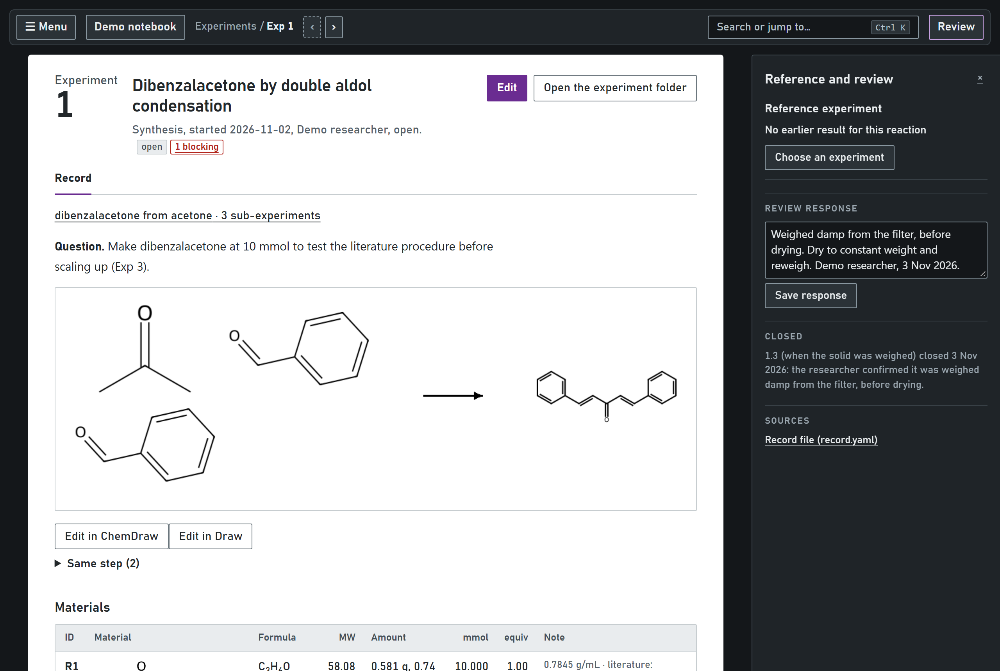
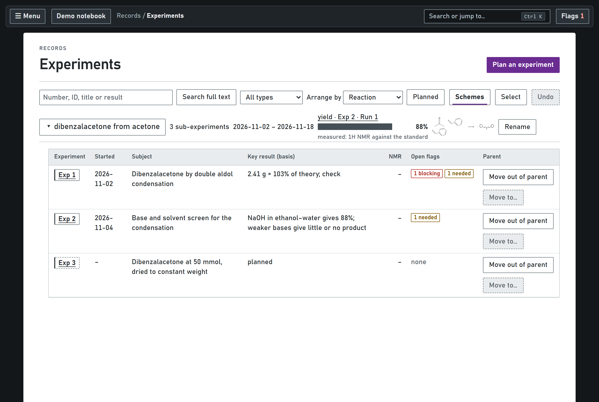

# Integrated Notebook for Organic Chemistry

The first project of **Agentic Research**



## Vision

Agentic Research aims to speed up fundamental science by letting software and AI agents carry the workflow around research. Much of a scientist's day goes to work that is necessary but routine. We believe agents can now do that work, and can also contribute where creativity and scientific judgment matter.

This raises the researcher's role. The researcher becomes both client and manager. As the client, the researcher brings the new scientific ideas and sets the overall goal. As the manager, the researcher delegates tasks to AI agents and reviews their scientific output.

Other groups are developing physical AI for the laboratory, such as robots and automated instruments. We are not working on that ourselves at present. We expect agentic workflows like ours to merge with it in the near future, and the two together to greatly speed up fundamental discovery.

## The first step: organic chemistry

We start with organic chemistry because our team combines expertise in organic chemistry with experience in software and web development. The larger aim covers fundamental science more broadly.

The Integrated Notebook for Organic Chemistry demonstrates that software and AI agents can now handle tasks that organic chemists perform every day and that take up their time and attention: planning experiments, finding chemicals, drawing structures and analyzing experimental data. Some of these tasks are mechanical, and handing them over frees the researcher's time and attention. Others benefit from an agent's input to the researcher's own creativity and judgment.

## What the notebook does

The notebook is a web app that runs on your own computer. Each experiment is one record. The app builds the bench card, the supporting-information draft, the index and the Word notebook from the records, so a fact is entered once.

| Task | What the notebook provides |
|---|---|
| Plan an experiment | Stoichiometry from the scale you choose, hazard prompts and a printable bench card that can show locations for bottles matched in your inventory |
| Find chemicals | Search of your inventory spreadsheets by name, abbreviation (DBU, DCM), CAS number or drawn structure, with a prompt when text-search results have the same recorded formula and different CAS numbers. An optional PubChem look-up supplies boiling point, melting point and density. |
| Keep experiments in order | Repeats of one reaction grouped under a parent, synthesis steps linked by matching product and reactant structures, and optional scheme previews on parent headings or individual experiments. Open Review to see the best comparable earlier result when one is available. |
| Draw and search structures | Draw a structure in the page, or paste or drop one from ChemDraw, to make the scheme. Search your structures by exact match, substructure, similarity or transformation. |
| Analyze data | NMR yields integrated against a standard, from a processed TopSpin spectrum or a raw Bruker 1D FID. Screening tables with yield bars and CSV export. |
| Write up | Supporting-information drafts from reviewed characterization, and a Word notebook rebuilt from the records |
| Run the lab day | A Today page with what is planned next. In the default project, a setting enables the schedule with clash warnings, supply counts and a waste log. |



The [user manual](nbapp/MANUAL.md) explains each page step by step.

## Work with an AI agent

You bring your own agent. Any agent that can run commands in your notebook folder will work; we use Claude Code and Codex. The project does not include or host an AI model.

When you start a notebook, the app writes a rules file for agents, `AGENTS.md`, in the project folder that contains your notebooks, if the file is missing. It tells the agent what to read, how to save and how to mark what it could not resolve. Edit it to suit your group.

The agent reads and saves records through a command line that applies the same checks as the app, so its work is held to the same rules as yours.

Run these commands from the repository folder. Set `$notebookRoot` to the data folder you use when starting the app. To preview a save, copy the record from `show` into `edit.yaml`, make your edits and replace `<hash>` with the hash from `show`.

```powershell
$notebookRoot = 'C:\path\to\your\notebook-workspace'
.\nbapp\runtime\python.exe nbapp\run.py --root $notebookRoot show 'My Case' EXP-001
.\nbapp\runtime\python.exe nbapp\run.py --root $notebookRoot save 'My Case' EXP-001 --file edit.yaml --by 'Agent' --expect '<hash>' --dry-run
.\nbapp\runtime\python.exe nbapp\run.py --root $notebookRoot validate 'My Case'
```

These safeguards let you delegate a task and then review the result:

- **A dry run shows what would change.** It prints the old and new value of each changed field, and each new result with its basis, before anything is saved.
- **Each save is logged** with its author and origin (browser or command line), and the previous version of the record is kept.
- **A stale save is refused.** With `--expect`, a save fails if the record changed after the agent read it.
- **Each result states its basis.** A new numeric result must say whether it is measured, recalculated, from slides, from the literature or a target. Target and literature values are drawn differently from measurements.
- **A refused save states its reason**, so the agent fixes the record and does not work around the check.

To watch the whole loop once, open the demo notebook and follow the [walk-through](nbapp/DEMO.md). An agent rechecks a yield, the save is refused until the result has a basis, and the researcher settles one of the two questions the agent raised.

The manual section [Work with an AI agent through the command line](nbapp/MANUAL.md#work-with-an-ai-agent-through-the-command-line) has the full workflow. The [record format](nbapp/SCHEMA.md) lists every field and who may write it.

## Get started

1. On 64-bit Windows, download [`Organic-Chemistry-Notebook-Windows-x64.zip`](https://github.com/fanchengyi0430-lab/IntegratedELN_OrganicChem/releases/latest/download/Organic-Chemistry-Notebook-Windows-x64.zip) and extract it using **Extract All**.
2. Open the extracted folder and double-click **Start Notebook.bat**. The ZIP includes Python, RDKit, NumPy and the Ketcher drawing editor. It works offline.
3. Under **Upload inventory workbook**, select your lab’s Excel workbook (`.xlsx`). You can also upload it later from **Inventory**.
4. Choose **Start a notebook** for your own work, or **Open a demo notebook** to try the sample experiments and teaching inventory.

Keep the launcher window open while you work. Close it to stop the app. To keep notebook data in a separate folder, run the launcher with that folder as its root.

```powershell
& ".\Start Notebook.bat" --root "C:\path\to\your\notebook-workspace"
```

If you downloaded the source ZIP or cloned the repository, double-click the same launcher. Its first run needs internet access to install the pinned chemistry tools inside the app folder. Later launches use the local installation.

The [app reference](nbapp/README.md) covers settings, the full command list, the runtime and the editor.

### Storage

| What to reserve space for | Recommended free space | Basis |
| --- | ---: | --- |
| Windows app, once per installation | **500 MB** | The portable ZIP is about 94 MB and the extracted app is about 267 MB. This allows room to keep both. |
| Each large notebook | **5 GB** | Allow room for experiment records, spectra, attachments and local backups. Actual usage depends on the number and size of the files you keep. |

Allow about **5.5 GB for the app and one large notebook**. Reserve additional space for separate backup copies or unusually large instrument datasets.

## Where your data goes

- **Nothing is sent to us.** We distribute code and reference tables and run no server. The app listens on your computer only (127.0.0.1), and your records, spectra and inventory stay in your folder.
- **PubChem is the only outside service the app contacts.** Automatic look-up is off by default. With look-up off, you can choose **Look up in PubChem** for one structure in a preview or an exact Inventory search. This sends its structure key (InChIKey). With look-up on, a preview can check up to ten unknown keys, and an exact Inventory search can check an unmatched key automatically. **Search PubChem** sends the compound name or CAS number you reviewed. Drawings and generated names stay on your computer.
- **You choose your AI agent.** If you use a hosted agent, its provider may receive the files and command output you share under the terms of your account. Decide what you let it read, especially unpublished results.

## Status and limits

This is an early release, built for our own bench work and tested on Windows.

- Each project folder serves one researcher on one computer. The app does not sync between computers or replace your lab's ELN.
- You review the science. Check the phase, baseline, integration regions and assignments of every NMR yield you use.
- Hazard prompts and waste reminders are prompts for review. They are not safety limits or compatibility checks, so follow your lab's procedures.

## How it was built

We built the notebook with AI coding agents, Claude Code and Codex, in the way the vision describes: we set the goals and reviewed the work.

## Team

Chengyi Fan (Lambert Group), Lichen Huang (Lambert Group) and Kerui Jian (Milner Group)

For questions and problems, open an issue on the project's GitHub page.

## License

The project is released under the [MIT License](LICENSE). The bundled PyYAML source carries its [upstream license](nbapp/vendor/yaml/LICENSE). The components of the packaged runtime and the structure editor keep their own licenses, listed in the [third-party notices](nbapp/THIRD_PARTY_NOTICES.md).
